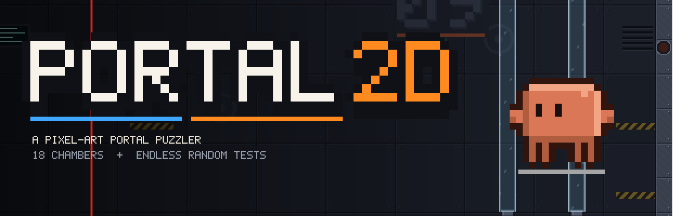

# Portal 2D: downloads

This repository only hosts **release builds** of Portal 2D, a pixel-art, side-scrolling portal puzzler.
The source code lives at [xandertaylorx/portal-2d-game](https://github.com/xandertaylorx/portal-2d-game) (source-available, not open source).

## Download

Get the latest version from **[Releases](https://github.com/xandertaylorx/portal-2d-releases/releases/latest)**:

| Platform | File |
|---|---|
| macOS (Apple Silicon) | `Portal2D-macOS-arm64-app.zip` |
| macOS (Intel) | `Portal2D-macOS-x64-app.zip` |
| Windows | `Portal2D-win-x64.zip`, then run `Portal2D.exe` |
| Linux | `Portal2D-linux-x64.zip`, then run `./Portal2D` |

> **macOS:** the app isn't notarised. The first time, right-click it and choose **Open**.

Once it's installed, the game checks this page for new versions and can update itself from the main menu.

## License

Copyright © 2026 xandertaylorx. Free to download and play for non-commercial purposes under the
[PolyForm Strict License 1.0.0](LICENSE.md). You may not sell, modify or redistribute it.

*Independent fan project, not affiliated with Valve Corporation. "Portal" is a trademark of Valve Corporation.*
